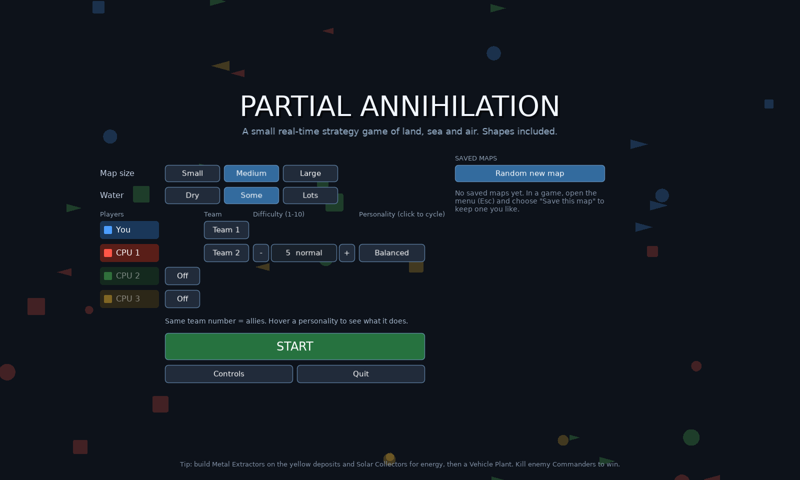

# Partial Annihilation

**A lightweight real-time strategy game for the Mac, in the spirit of Total Annihilation, where the units are shapes and numbers.**

Land, sea and air. Up to 4 players with teams. Procedural maps. The whole game is about 60 KB of Lua, and it runs on the tiny [LÖVE](https://love2d.org) engine, which runs natively on Apple Silicon. It was built to stay out of the way on a machine that's busy doing other things, like running a local AI model.


## What makes it different

- **Select Half.** Press `H` to cut your selection in half while keeping the same mix of unit types, choosing the half nearest your mouse. `Shift+H` flips to the other half. Splitting an army into two groups is four keys: `H`, `Ctrl+1`, `Shift+H`, `Ctrl+2`. The idea comes from AI War.
- **Retreat has a real cost.** `F` pulls units back to your rally flag (or to the Commander with `Shift+F`) at +25% speed. Their weapons stay **offline until they're fully repaired**, so if the enemy chases, they're defenseless. Units repair slowly near your Commander or factories, or faster with constructors. The computer plays by the same rules.
- **Separate difficulty and personality settings.** Difficulty runs from 1 to 10, and there are seven personalities: *Balanced, Aggressive, Turtle, Boomer, Air, Naval, Raider* (plus *Random*). Each computer player gets its own pair, so a level-3 Turtle and a level-8 Raider can share a map.
- **Up to 4 players, any teams.** Free-for-all, 2v2, 1v3, or you plus a computer ally against two. You see whatever your allies see. When a player's Commander falls, their forces self-destruct. The last alliance standing wins.
- **Drag-to-build, nearest first.** Drag a box with a building selected. Extractors go on every free deposit inside it. Anything else fills the box in a neat grid with walkways. The jobs are split between your selected constructors so each one takes the closest work first.
- **Factory output joins a control group.** With a factory selected, `Option+1-9` sends everything it builds straight into that group.
- **Veterancy for everything.** Units, defense towers and your Commander all earn experience and level up to 5, gaining damage, health, fire rate, range and speed. Gold chevrons show the level.
- **Total Annihilation-style economy.** Metal from extractors, energy from solar. Everything costs both and builds over time. If you overspend, every project slows down by the same amount instead of the oldest one hogging everything.
- **Procedural symmetric maps you can keep.** Every map is fair: mirrored for 2 players, four-way for 3-4. If you like a map, save it with a name and pick it again later from the title screen.
- **Quality-of-life touches:**
  - a sidebar listing every factory and builder, with idle ones highlighted
  - a follow camera (`L`) and a cinematic camera (`Shift+L`)
  - right-drag panning
  - mouse lock so edge-panning works in a window
  - clickable game-speed controls
  - flak with splash damage that shreds aircraft flying in formation

| | |
|---|---|
|  |  |

## Units

Shapes tell you the domain, and the number tells you the type:

| Shape | Domain | Units |
|---|---|---|
| Square | Land | Constructor (B), Scout (1), Tank (2), Artillery (3), Flak Truck (4), Commander (CMD) |
| Triangle | Air | Fighter (1), Bomber (2), Gunship (3) |
| Circle | Sea | Patrol Boat (1), Destroyer (2), Submarine (3, only ships can hit it) |

**Buildings:**
- Metal Extractor
- Solar Collector
- Storage
- Vehicle Plant
- Aircraft Plant
- Shipyard
- Gun Tower
- AA Tower

## Playing on a Mac

1. Install **LÖVE 11.5** from [love2d.org](https://love2d.org) (the macOS download is a universal app). Move `love.app` into Applications.
2. Build the game file. Run `tools/build.sh`, or zip the contents of this folder (`main.lua`, `conf.lua`, `src/`) into `PartialAnnihilation.love`.
3. Run it with `open -n -a love PartialAnnihilation.love`, or drag the `.love` file onto `love.app`.

The same `.love` file runs on Windows and Linux with LÖVE 11.5.

## Controls

| Action | Keys |
|---|---|
| Select / add | Left-click or drag; Shift adds; double-click selects all of a type on screen |
| Move / attack / assist | Right-click (Shift queues) |
| Attack-move, Stop, Patrol | `A` then click, `S`, `P` then click |
| Retreat to flag / Commander | `F` / `Shift+F`; plant the flag with `Ctrl+F` |
| Select all combat units | `Ctrl+A` / `Cmd+A` |
| Select half / other half | `H` / `Shift+H` |
| Control groups | `Ctrl+1-9` save, `Shift+1-9` add, `1-9` recall (tap twice to jump there) |
| Build / produce | `Q W E R T Y U I` with a constructor or factory selected; drag for an area |
| Factory output to group | `Option+1-9` (`Option+0` clears) |
| Camera | Scroll to zoom; right- or middle-drag, arrow keys or screen edge to pan; `Option`+scroll pans |
| Follow / cinematic camera | `L` / `Shift+L` |
| Jump to Commander / last attack | `C` / `Space` |
| Idle constructor | `Tab` |
| Sidebar, speed, pause | `B`; `+`/`-`; `F3` (the top bar is clickable too) |
| Help | `F1` |

## How it's built

Plain Lua on LÖVE 11.5, with no other dependencies.

| File | What it does |
|---|---|
| `src/map.lua` | Procedural symmetric maps and connectivity |
| `src/path.lua` | A* pathfinding with smoothing and per-frame budgets |
| `src/world.lua` | The simulation: economy, construction, combat, veterancy, fog of war, retreat and repair |
| `src/ai.lua` | Computer opponents: economy, production, waves, raids, retreating, multi-enemy targeting |
| `src/game.lua`, `src/ui.lua`, `src/render.lua` | Input, the HUD and drawing |
| `src/menu.lua`, `src/maps.lua` | Lobby and saved maps |
| `src/sfx.lua` | Procedurally generated sound effects (no audio files) |

### Testing

Computer-vs-computer games run headless at high speed:

```sh
love . --autotest 25 <seed> <size> <level1> <profile1> <level2> <profile2>
love . --autotest4 30 <seed> 128 ffa|2v2|3
love . --smoketest     # a scripted "player" drives the real input handlers
```

## License

MIT. See [LICENSE](LICENSE).
