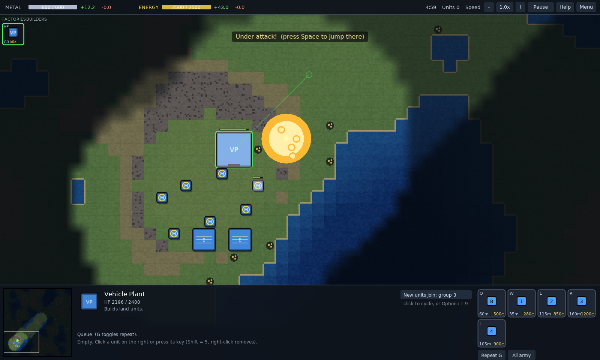

# Partial Annihilation

**A lightweight real-time strategy game for the Mac, in the spirit of Total Annihilation, where the units are shapes and numbers, your Commander levels up like a roguelike hero, and the soundtrack goes to war with you.**

Land, sea and air. Up to 4 players with teams. Procedural maps. About 80 KB of Lua plus 3 MB of music, on the tiny [LÖVE](https://love2d.org) engine, running natively on Apple Silicon. It was built to stay out of the way on a machine that's busy doing other things, like running a local AI model.


## What makes it different

### Your Commander is a roguelike hero with a nuke
Lose him and you lose the game, but he only grows by fighting. He levels up **only from his own kills**. At levels 1 to 4 you pick **1 of 2 random upgrades from a pool of 20**, and whatever you take never comes up again, so no two Commanders are built the same way. The pool includes:
- Second Wind and Emergency Recall
- Repair Aura and Inspiring Presence
- Explosive Shells and a Flak Mount
- Resource Siphon and Salvager
- instant veteran Reinforcements, and more

**Level 5 is always the Nuke.** Every player hears the warning and watches the slow missile and its target circle. It flattens every building in the blast (yours too, if you aim badly) and halves the health of every unit caught in it. Commanders are immune, and it takes 10 minutes to recharge. Every fight that makes him stronger is also a chance to lose everything.

### Every match is a scored run on a seasonal online leaderboard
Kills pay out the metal value of what you destroy. A kill-streak multiplier climbs to x3 and resets after 10 seconds without an enemy death (the window tightens as the streak grows). At the end your points are scaled by how strong the enemies were, by **how stacked the odds were** (1v2 against a team pays far more than a free-for-all where the computers also fight each other) and by your time against par, which grows with every extra enemy you face. The victory screen breaks down every number. Clean games go on your high-score table, and one click submits them to the **[online leaderboard](LEADERBOARD.md)**, which resets with every new version so each release is a fresh season.

### A soundtrack that follows the fighting, and a robot announcer
The score is three tempo-locked orchestral layers that crossfade with the action:
- **quiet:** strings, choir and harp
- **enemies in sight:** cellos, tremolo strings and timpani
- **a real battle:** full brass and war drums

Victory and defeat get their own fanfares. A robotic voice calls out "Warning. Nuke en route.", "Commander under fire", "Dropship approaching", "Alien tech secured", stalled economies and more.

### Modifiers that change how a match plays
- **Alien Tech:** an enormous alien walker is announced and then lands near the middle of the map. Hold its zone uncontested for 15 seconds to make it yours, king-of-the-hill style. Then the next one lands somewhere else.
- **Dropships:** from minute 3, neutral alien crews drop and wander the map. When one meets you, the game pauses on a **coin flip**: heads they join you, tails they open fire.
- **Groovy:** explosions become flowers, the palette goes 1970, and the landscape slowly trips out.

Combine them however you like. Score keeps running, but only games without Alien Tech or Dropships count as official.

### Metal you have to go and take
Metal near your base is scarce. Most deposits sit out in the contested middle of the map, and the richest ones (+2.6 metal, against +1.6 for a normal deposit) are a gold-ringed cluster at the very center and teal-ringed fields offshore. Turtling at home means falling behind.

### A navy worth fighting for
Most maps are ringed by ocean, and every body of water connects. Much of the richest metal sits offshore, and only Sea Constructors can reach most of it. They also build Tidal Generators, which outproduce solar. A player who hides inland is leaving that economy to whoever controls the sea.

The **Battleship** brings the sea to the land. It shells anything within 25 tiles: not much damage per shot, but constant pressure on a whole base. It's slow and expensive, and it can't hit aircraft or submarines, so everyone hunts it. The computer players send bombers and subs after any battleship near their base, escort their own with destroyers, and either besiege your coast or keep it home as a harbor guard.

### Retreat has a price
`F` pulls units back at +25% speed, but their weapons stay offline until they're fully repaired. Fleeing saves units, and it also leaves them defenseless if the enemy gives chase.

### Opponents with personalities, and Commanders they actually use
Difficulty (1–10) and personality are set separately for each computer player. The personalities are *Balanced, Aggressive, Turtle, Boomer, Air, Naval, Raider* and *Warlord*, a Commander who leads every assault from the front. Computer players pick upgrades that fit their style. They level their Commander when the odds are good and pull him back to their strongest position when hurt. They also aim nukes at your most valuable targets while keeping clear of their own buildings.

### Small, and it updates itself
The whole game is a 3 MB file. The title screen checks GitHub and updates to the newest build in one click, and every match writes a readable log (minute-by-minute economy, armies, key moments and the score breakdown) for anyone who wants to dig into balance.

## Also included
- **Up to 4 players and any teams:** free-for-all, 2v2, 1v3, or you with a computer ally, sharing vision.
- **Procedural, symmetric maps:** an ocean ring with bays and rivers on most of them. Save the seeds you like by name.
- **Total Annihilation-style economy:** overspending slows every project by the same amount.
- **Veterancy for every unit, including towers.**
- **Every order is a button**, with its shortcut and a tooltip.
- **Drag-to-build:** fills an area with buildings, with each constructor taking the nearest jobs first.
- **Factory output can join a control group** automatically.
- **Camera and interface extras:** follow and cinematic cameras, a sidebar of factories and builders, and a clickable game speed.

| | |
|---|---|
|  |  |
|  |  |
|  |  |

## Units

Shapes tell you the domain, and the number tells you the type:

| Shape | Domain | Units |
|---|---|---|
| Square | Land | Constructor (B), Scout (1), Tank (2), Artillery (3), Flak Truck (4), Commander (CMD) |
| Triangle | Air | Fighter (1), Bomber (2), Gunship (3) |
| Circle | Sea | Sea Constructor (B), Patrol Boat (1), Destroyer (2), Submarine (3, only ships can hit it), Battleship (4, long oval hull) |

**Buildings:**
- Metal Extractor
- Solar Collector
- Tidal Generator (on water)
- Storage
- Vehicle Plant
- Aircraft Plant
- Shipyard
- Gun Tower
- AA Tower

## Playing on a Mac

1. Install **LÖVE 11.5** from [love2d.org](https://love2d.org) (the macOS download is a universal app). Move `love.app` into your **Applications** folder. If you run it straight from Downloads, macOS launches it from a temporary hidden copy, so any folder permission you grant doesn't stick and you'll be asked again on every launch.
2. Build the game file. Run `tools/build.sh`, or zip the contents of this folder (`main.lua`, `conf.lua`, `src/`, `assets/`) into `PartialAnnihilation.love`.
3. Run it with `open -n -a love PartialAnnihilation.love`, or drag the `.love` file onto `love.app`.

Or download the newest build directly: [`dist/PartialAnnihilation.love`](dist/PartialAnnihilation.love). After that, the game updates itself from its title screen.

The same `.love` file runs on Windows and Linux with LÖVE 11.5.

If you keep the game in Documents, Desktop or Downloads, macOS asks once whether LÖVE may use that folder (the game reads itself from there and writes its match logs beside it). Allow it once and you won't be asked again. A folder like `~/Games` doesn't ask at all.

## Controls

| Action | Keys |
|---|---|
| Select / add | Left-click or drag; Shift adds; double-click selects all of a type on screen |
| Move / attack / assist | Right-click (Shift queues) |
| Attack-move, Stop, Patrol | `A` then click, `S`, `P` then click |
| Plant retreat flag | `Ctrl+F` at the mouse (or the Flag button, then click) |
| Self-destruct selection | `Delete` (unfinished buildings refund their metal; the Commander needs two presses) |
| Drop last queued order | `Shift+Delete` |
| Retreat to flag / Commander | `F` / `Shift+F`; plant the flag with `Ctrl+F` |
| Commander upgrade choice | `Z` / `X` (or click a card) |
| Nuke (Commander level 5) | `N`, then click the target |
| Select all combat units | `Ctrl+A` / `Cmd+A` |
| Select half / other half | `H` / `Shift+H` |
| Control groups | `Ctrl+1-9` save, `Shift+1-9` add, `1-9` recall (tap twice to jump there) |
| Build / produce | `Q W E R T Y U I` with a constructor or factory selected; drag for an area |
| Factory output to group | `Option+1-9` (`Option+0` clears) |
| Camera | Scroll to zoom; right- or middle-drag, arrow keys or screen edge to pan; `Option`+scroll pans |
| Follow / cinematic camera | `L` / `Shift+L` |
| Jump to Commander / last attack | `C` / `Space` |
| Idle constructor | `Tab` |
| Sidebar, speed, pause | `B`; `+`/`-`; `F3` (the top bar is clickable too) |
| Sound effects / music / announcer | `M` / `Shift+M` / `V` |
| Help | `F1` |

## How it's built

Plain Lua on LÖVE 11.5, with no other dependencies.

| File | What it does |
|---|---|
| `src/map.lua` | Procedural symmetric maps and connectivity |
| `src/path.lua` | A* pathfinding with smoothing and per-frame budgets |
| `src/world.lua` | The simulation: economy, construction, combat, veterancy, fog of war, retreat and repair |
| `src/ai.lua` | Computer opponents: economy, production, waves, raids, retreating, Commander tactics, nuke targeting, multi-enemy targeting |
| `src/commander.lua` | Commander levels, the 20-upgrade pool and the Nuke |
| `src/mods.lua` | Game modifiers: Alien Tech, Dropships, Score mode |
| `src/scores.lua`, `src/online.lua` | Local high scores; update check, one-click update and online leaderboard (via `curl` and GitHub) |
| `src/matchlog.lua` | Per-game logs for balance review |
| `tools/leaderboard.py`, `.github/workflows/leaderboard.yml` | The leaderboard bot: checks a submitted score issue, updates `LEADERBOARD.md`, then replies and closes the issue |
| `src/game.lua`, `src/ui.lua`, `src/render.lua` | Input, the HUD and drawing |
| `src/menu.lua`, `src/maps.lua` | Lobby and saved maps |
| `src/sfx.lua` | Procedurally generated sound effects |
| `src/music.lua`, `src/voice.lua` | Intensity-driven music crossfading and the announcer queue |
| `tools/compose.py`, `tools/voices.py` | Compose the score as MIDI and render it with FluidSynth (FluidR3 GM soundfont, MIT); render the announcer with espeak-ng plus a ring-modulator robot filter |

### Testing

Computer-vs-computer games run headless at high speed:

```sh
love . --autotest 25 <seed> <size> <level1> <profile1> <level2> <profile2> [--mods alien,drops,groovy]
love . --autotest4 30 <seed> 128 ffa|2v2|3
love . --smoketest     # a scripted "player" drives the real input handlers
```

### Releasing

Bump `VERSION` and `D.VERSION` in `src/defs.lua` together, then run `tools/build.sh` (it refreshes `dist/PartialAnnihilation.love`) and push. Players get the update from the title screen, and the leaderboard starts a new season for the new version.

## License

MIT. See [LICENSE](LICENSE).
