# Partial Annihilation

**A lightweight real-time strategy game for the Mac, in the spirit of Total Annihilation, where the units are shapes and numbers, your Commander levels up like a roguelike hero, and the soundtrack goes to war with you.**

Land, sea and air. Up to 4 players with teams. Procedural maps. About 130 KB of Lua plus 8 MB of music, on the tiny [LÖVE](https://love2d.org) engine, running natively on Apple Silicon. It was built to stay out of the way on a machine that's busy doing other things, like running a local AI model.

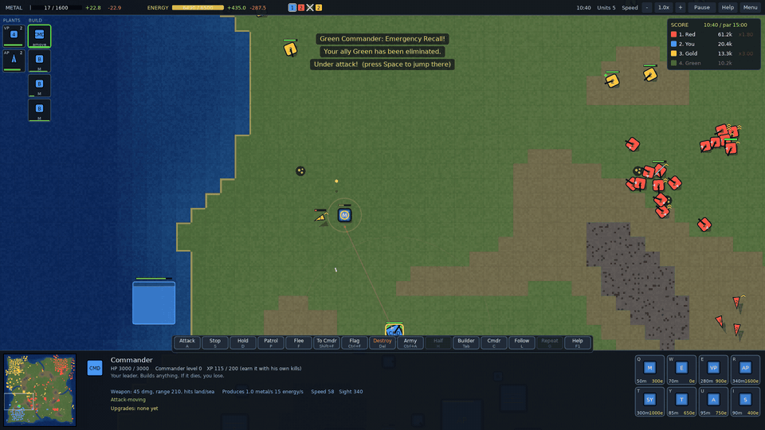

**[Play it in your browser](https://brianchase515.github.io/partial-annihilation/)**, or [download](#download) it for Windows, Mac, Linux and the Steam Deck.

**Three games in one:** **Annihilation**, the full Total Annihilation-style RTS; **Commander Arena**, a lane-battle mode where you control only your Commander; and **Commander Craft**, a Warcraft-style mode with workers, races and heroes.

| Mode | Version | Status |
|---|---|---|
| Annihilation | 0.8 | Mostly feature complete; still being balanced and polished. |
| Commander Arena | 0.6 | Playable end to end; heroes and maps still being tuned. |
| Commander Craft | 0.4 | Early: the core is in, races, heroes and maps are still changing a lot. |

The package version (shown in the corner of the title screen) covers all three; it's what the updater and the high-score seasons use.

## What makes it different

### Commander Craft: a Warcraft-style mode
Switch the title screen to **COMMANDER CRAFT** for a classic fantasy-RTS ruleset with our heroes.
- **Two asymmetric races.**
  - **Vanguard** (order and steel): Footmen, Riflemen, Knights, Clerics, Magi, Mortar Teams and Gryphon Riders.
  - **Warband** (tribes and beasts): Grunts, Headhunters, Raiders, Shamans, Mystics, Demolishers, Wyvern Riders and Ironhides.
  - Each race has its own workers, farms, barracks, altar, smithy, tower and tech buildings, and its own hero classes taken from the Arena: Warden, Ranger, Elementalist, Ascetic and Infiltrator for the Vanguard; Juggernaut, Shifter, Hexer, Spiritcaller and Reclaimer for the Warband.
- **Gold and wood.** Workers mine gold (one at a time inside a mine, about five per mine) and chop trees, carrying it home to a hall or mill. Mines run dry.
- **Food and upkeep.** Every unit costs food (farms and halls provide it, up to 80). Above 40 food your gold income drops 30%, above 60 it drops 60%.
- **Three tiers.** Town Hall → Keep → Castle (Great Hall → Stronghold → Fortress) unlock units, buildings, research and your 2nd and 3rd hero.
- **No free upgrades.** Units never level up. Every improvement is bought: weapons and armor (three levels) at the Blacksmith / War Mill, and each production building researches upgrades for its own units (Defend, Long Rifles, Berserker Strength, Ensnare, Pulverize and more).
- **Heroes.** You start with your class's hero and one skill. Levels come from enemies and creeps dying nearby, each with a card (skills at 2 and 4, the ultimate at 6). Heroes heal fast by your halls and rise again at your altar. Flee (F) works for them too. The **hero bar** (top right) shows every hero's health and each skill's cooldown as a clock sweep; click a skill to cast it. With several heroes selected, **C** switches which one Q W E R control without losing the selection.
- **Seven maps** (or Random), all original layouts inspired by classic fantasy-RTS maps:
  - **Horseshoe:** a U of land around a lake, corner expansions, a rich mine on the middle peninsula guarded by gnolls and an Ogre Warlord.
  - **Old Temple:** open ground, bases in opposite corners, two expansions each, and a walled plaza in the middle.
  - **Shallow Isles:** islands joined by shallow fords around a lake, with the rich mine on a small middle island.
  - **Serpent Glade:** one long road winding through deep forest past pocket expansions, plus a narrow hunters' trail.
  - **Horseshoe Classic:** a smaller, quicker Horseshoe with only three gold mines: yours, theirs, and the rich one across the contested beach.
  - **Wildlands:** creep-heavy, with eleven camps guarding every expansion and the roads between them.
  - **Crossroads (2v2):** you and a computer ally against two enemies. Each team is one race, and heroes can repeat across players.
- **Melee matters.** Swords, axes and cavalry have to reach their target; ranged units and towers can hit flyers; siege wrecks buildings; casters heal, slow and bloodlust on their own.
- **A computer opponent (difficulty 1-10)** that works its economy, creeps with its heroes, expands, techs up and attacks. Levels 8-10 also mine 10-30% faster.
- **Its own soundtrack**: seven fantasy suites (Banners of Dawn, Drums of the Warband, Moonlit Grove, Frostpeak Vigil, Caravan of Sands, The Elven Watch, Siege of Ironhold). Annihilation keeps its five; the Arena mixes all twelve.

### Commander Arena: a single-player lane battler
Switch the title screen to **COMMANDER ARENA** for a different game. There's no base and no army: just your Commander, three lanes, towers, a Core to protect, and endless waves of creeps marching at the enemy.
- **Ten classes inspired by classic action-RPG archetypes, each with five skills and an ultimate:**
  - **Ranger:** volleys, lances, decoys.
  - **Elementalist:** fireballs, frost, teleport. Ultimate: Meteor.
  - **Reclaimer:** rebuilds wrecked enemy creeps as its own drones.
  - **Juggernaut:** a melee brawler; leaps, war cries, Berserk.
  - **Warden:** auras for your creeps, charges and smites.
  - **Shifter:** a wolf pack, bear form, cyclones.
  - **Infiltrator:** trap turrets, stealth, a shadow clone.
  - **Ascetic:** a melee monk; flurries, dashing strikes, mantras, healing breath, a sanctuary that halves damage.
  - **Hexer:** plague darts, a ghoul retinue, hexes that turn enemy creeps into walking bombs, a Gargantuan.
  - **Spiritcaller:** four spirit stances (Jaguar, Gorilla, Eagle, Centipede), one at a time, each reshaping every attack.
- **Roguelike levels to 10.** Levels 2, 4 and 8 offer 1 of 2 class skills (cast with Q/W/E at the mouse), level 6 unlocks your ultimate (R), and the other levels offer upgrade cards.
- **Death isn't the end.** Your Commander respawns at your Core. Towers must fall in order (outer, inner, then the Core), and a lane whose towers are down sends super creeps.
- **Computer opponents that play like it:** they farm behind their creep wave, avoid tower fire, retreat home to heal, dive a weakened Commander, gang up with allies and use their skills. Higher difficulties last-hit and deny, back off from a stronger Commander, and lead their skill shots; 8-10 also learn 10-30% faster (the menu says so when you hover a difficulty).
- **1v1 up to 5v5, 1v2, 2v1, or a 3- or 4-way free-for-all** (5v5 starts on a Huge map: two Commanders top, one mid, one bot and a jungler on Battlefield) (bases on a triangle or in every corner, with a lane between each pair of bases), with its own scoring, high scores and online leaderboard.
- **Six map templates:**
  - **Classic:** three lanes, two towers each.
  - **Long Road:** winding lanes walled in by rock, with three towers each, for longer games.
  - **Gauntlet:** one wide lane, three towers deep.
  - **Open Field:** almost no rock between the lanes, so roaming and ganks rule.
  - **Treeline** (built for 3v3): two lanes with a jungle between them.
  - **Battlefield** (DOTA style): three lanes, a river across the other diagonal, and jungle in every quarter.
  - Treeline and Battlefield are randomized every match and always mirror-fair.
- **The jungle** (Treeline and Battlefield):
  - **Neutral camps** of Scavengers and Ravagers only fight if you start it. They give XP, chase you a short way, then walk home and heal.
  - **Two capture shrines:** stand on one to take it. Each shrine you hold gives your side's Commanders +8% speed and damage.
  - **The Colossus** wakes in its pit at 7:00. Bring it down and your whole side gets the **Colossus Crest**: stronger Commanders and stronger creeps for 2 minutes. On Battlefield it alternates between two pits.
  - **Healing relics** respawn every 70 seconds.
  - Computer Commanders farm camps, contest shrines and gang up on the Colossus. On Treeline the third Commander of a side is a jungler; on Battlefield the fourth.
- **Last-hitting and denying:** hold `D` to hold fire and time the killing shot, which gets the full experience. Finish off your own dying creep to deny it to the enemy.
- **Creep veterancy:** creeps that land killing blows rank up (gold pips, up to 3), getting +12% health and damage each rank and becoming worth more experience. Denying your dying creep doesn't just starve the enemy Commander; it stops the enemy creep that was about to rank up off it. Computer players from difficulty 4 deny too, more often the better they are.

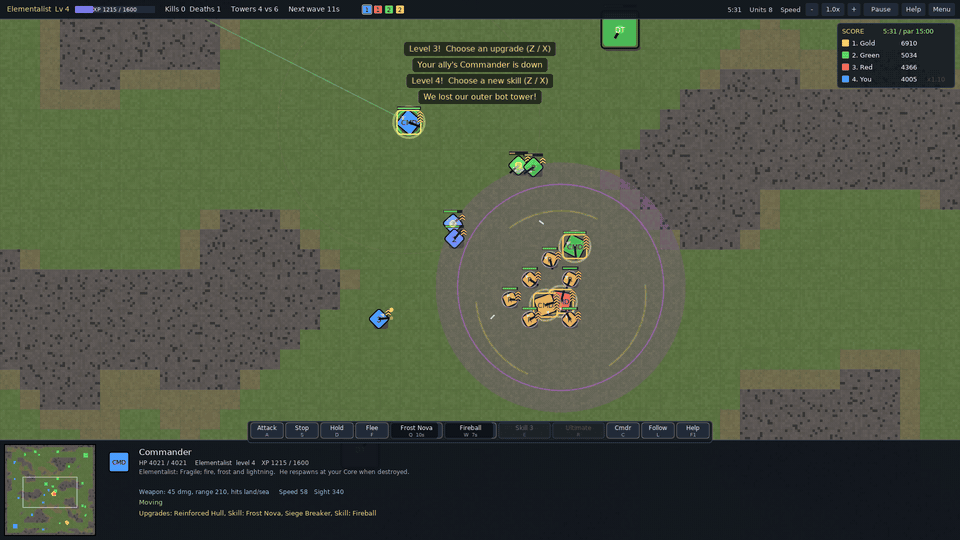


### Commander of Heroes: squads, skills and capture points

A fourth mode, in the spirit of Company of Heroes, built on Annihilation's units. There's no economy and no base building: each side has a Field HQ and two to five squads you pick before the match. Every squad is one kind of unit, led by a veteran of that kind.

- **Squads, not armies.** 1-5 always select that squad wherever it is (Shift adds it, twice jumps to its leader); clicking any unit selects its whole squad (Alt-click for one unit). Every squad has a card in the bottom panel: click to select, hover a skill to read it, click a skill to use it. With several squads selected, one is the **active** squad (gold): Q / W fire its skills only, and C moves the gold to the next selected squad. To pull back just one squad while several are selected, press Alt+its number or the Flee button on its card. On the map its leader wears a gold beacon with the reach of his skills marked, and its members get gold rings (also a gold ring on the minimap). Squads move at their own pace and march in ranks on attack-move.
- **Squad types, two skills each (Q / W, at the mouse):** Armor (4 Tanks): Hull Down and Smoke Screen. Battery (3 Artillery): Barrage (a red marker shows where six heavy shells will land) and Rapid Fire. Recon (5 Scouts, with light anti-air guns): Flare and Sprint. Air Defense (3 Flak Trucks): Flak Barrage and Field Repair. Gunships (3, one air squad a side; aircraft can't take points): Strafing Run and Afterburner. Skills run on cooldowns; the squad panels show them (click one to cast).
- **Capture points and tickets.** Five points: one near each base, three across the middle. Ground units standing on a point take it (aircraft can't). Hold more than the enemy and their tickets drain; every unit lost costs tickets too. Win when they run out, or when their HQ falls (an HQ can't be hurt while its side holds at least one point: a blue dome shows the shield, a flashing red ring means it's open). Quick, Standard and Long games (about 5-7, 10-12 and 18 minutes) set the ticket pools and par.
- **Fall back, come again.** Units heal fast at the HQ; fallen members are replaced there (faster the more points you hold) and walk back out to their leader on their own (the panel shows "+N coming"; if he is fleeing they wait for him where he is headed); a fallen leader returns after 45 seconds.
- **Built for people, not just bots.** Squad units are 60% tougher than in Annihilation, so fights last long enough to read and use skills, and points take 14 s to take. Lower difficulties also limit the bot's attention: it only looks after one or two squads at a time (level 9-10 manage them all).
- **Terrain matters.** Hills see 30% further but take 15% more damage; bunkers (sandbag rings) cut damage by 40% and sight by 30%. The computer uses them too. Tanks carry a light anti-air machine gun, and Recon's guns hit aircraft hard.
- **Named crews.** Every unit has a name and rank (Sgt. Price, Pvt. Kowalski...), shown on the squad cards with their health; the fallen stay listed as KIA.
- The computer fights with combined arms: armor leads, the battery hangs back at the edge of its reach, AA rides with the guns, air goes for your artillery. In War is Hell it's one force with recon screening ahead. In Conquest its scouts raid points on their own while the rest march in order - with four or more squads, as two groups on two points.
- Direct fire can miss: shooting on the move, at a fast mover or into a bunker is harder; veterans and leaders shoot straighter. Two scouts meeting usually goes to the one that stopped to shoot.
- **War is Hell** (a second game type, with a camouflage title screen): no HQ, no points, no reinforcements - when they die, they die. Deep fog on a rougher, medium map with more hills and bunkers; find the enemy and destroy every last unit. A fallen leader's best survivor takes command. Brutal: blood on the ground, screams and wounded cries over a field radio (one voice at a time, never over the announcer), heavier, deeper gunfire and explosions, and its own grim score (No Man's Land, Iron Rain, The Long Night). Hover the ground to see what a hill or bunker does; squad cards show who's on high ground (^) or in a bunker (#). The computer only knows what its side can see, sweeps for you, and dives into bunkers when the shooting starts. The wounded leave a trail of blood you can follow once your men have laid eyes on it (it dries up after three minutes). Men who run from the fight have laid down their arms: an enemy squad that pulls back, or the last men of a side that's outnumbered, stops shooting and falls back to where they came in, bleeding as they go, and nothing chases them down by itself. Follow the blood. When your men find them there, the game stops on a memorial - everyone you've lost, by name and age, and who each of them leaves behind - and you choose: **Have mercy** (they're taken prisoner) or **Kill 'em all** (they wait under a white flag, pleading, until you finish it). No robot announcer here: just the men, and a distant battle all around. The computer fights as one combined force: its recon screens ahead and spots, the armor leads, the battery hangs back at the edge of its reach and shells whatever the others can see, AA rides with the guns and air goes for your artillery. Some games it holds good ground and makes you come to it. Anything that shells it from the fog gets hunted down.
- 1v1 or 2v2 on a small or medium map, difficulty 1-10. The enemy picks its own squads or mirrors yours (good for learning). Not scored yet (mode version 0.1).

### Your Commander is a roguelike hero with a nuke
Lose him and you lose the game, but he only grows by fighting. He levels up **only from his own kills**. At levels 1 to 4 you pick **1 of 2 random upgrades from a pool of 20**, and whatever you take never comes up again, so no two Commanders are built the same way. The pool includes:
- Second Wind and Emergency Recall
- Repair Aura and Inspiring Presence
- Explosive Shells and a Flak Mount
- Resource Siphon and Salvager
- instant veteran Reinforcements, and more

**Level 5 is always the Nuke.** Every player hears the warning and watches the slow missile and its target circle. It flattens every building in the blast (yours too, if you aim badly) and halves the health of every unit caught in it. Commanders are immune, and it takes 10 minutes to recharge. Every fight that makes him stronger is also a chance to lose everything.

### Every match is a scored run on a seasonal online leaderboard
Kills pay out what you destroy is worth (its metal plus a tenth of its energy), and towers, AA and sea batteries pay a 1.5x siege bonus, so cracking a fortified Turtle is worth the trouble. A kill-streak multiplier climbs to x3 and resets after 10 seconds without an enemy death (the window tightens as the streak grows). At the end your points are scaled by how strong the enemies were, by **how stacked the odds were** (1v2 against a team pays far more than a free-for-all where the computers also fight each other) and by your time against par, which grows with every extra enemy you face. Speed pays: winning in half the par time doubles your score, and a third of it triples it. The victory screen breaks down every number. Clean games go on your high-score table, and one click submits them to the **[online leaderboard](LEADERBOARD.md)**, which resets with every new version so each release is a fresh season.

### A soundtrack that follows the fighting, and a robot announcer
The score is three tempo-locked orchestral layers that crossfade with the action:
- **quiet:** strings, choir and harp
- **enemies in sight:** cellos, tremolo strings and timpani
- **a real battle:** full brass and war drums

There are five soundtracks, and a match rotates through them every couple of loops so a long game never sits on one tune. Battles have their own sound too: rifle cracks, energy guns, heavy cannons, artillery that booms across the map, shell impacts, flak and explosions. All of it is synthesized from scratch, panned to where it happens on screen and quieter the further away it is.

Victory and defeat get their own fanfares. A robotic voice calls out "Warning. Nuke en route.", "Commander under fire", "Dropship approaching", "Alien tech secured", stalled economies and more.

### Modifiers that change how a match plays
- **Alien Tech:** an enormous alien walker is announced and then lands near the middle of the map. Hold its zone uncontested for 15 seconds to make it yours, king-of-the-hill style. Then the next one lands somewhere else.
- **Dropships:** from minute 3, neutral alien crews drop and wander the map. When one meets you, the game pauses on a **coin flip**: heads they join you, tails they open fire.
- **Groovy:** explosions become flowers, the palette goes 1970, and the landscape slowly trips out.
- **Metal Alert:** only a quarter of the metal deposits, but each is worth three times as much, and the metal has to travel. Every extractor comes with its own **ore truck** that hauls loads to your **Refinery** (you start with one; build more). Kill a truck and that extractor needs a minute to roll out a new one, and rebuilding the extractor doesn't skip the wait.
- **Sandbox** (a game type, next to Standard): pick any army for each side, up to 300 of every unit type, and they start beside the Commanders. One Commander each; losing yours still ends it. Never scored, never teaches Mirror or Nemesis.
- **Post-Apocalypse:** no Commanders. Everyone starts with a single Constructor and wins by wiping out every enemy unit and building. At 10:00 the fog of war lifts for good.

Combine them however you like. Score keeps running, but only games without gameplay modifiers (Groovy is cosmetic) count as official, or teach Mirror and Nemesis.

### Metal you have to go and take
Metal near your base is scarce. Most deposits sit out in the contested middle of the map, and the richest ones (+2.6 metal, against +1.6 for a normal deposit) are a gold-ringed cluster at the very center and teal-ringed fields offshore. Turtling at home means falling behind.

### A navy worth fighting for
Most maps are ringed by ocean, and every body of water connects. Much of the richest metal sits offshore, and only Sea Constructors can reach most of it. They also build Tidal Generators, which outproduce solar. A player who hides inland is leaving that economy to whoever controls the sea.

Wetter maps carry long inlets deep into the land on every side, so a navy can reach almost anywhere. Sea Constructors also build **Sea Batteries**: floating gun platforms, tougher than land towers, that hit land, sea and air.

The **Battleship** brings the sea to the land. It shells anything within 40 tiles, far enough to reach the middle of the map from the coast: not much damage per shot, but constant pressure on a whole base. It's slow and expensive, and it can't hit aircraft or submarines, so everyone hunts it. The computer players send bombers and subs after any battleship near their base, escort their own with destroyers, and either besiege your coast or keep it home as a harbor guard.

### Retreat has a price, and your Commander needs a home
`F` pulls units back at +25% speed, but their weapons stay offline until they're fully repaired. Fleeing saves units, and it also leaves them defenseless if the enemy gives chase.

Your Commander can flee too, at +50% speed, but he only repairs at his starting spot. There he powers down until he's whole again, which turns your start into a real base: hit-and-run with him is fine, and the way to kill an enemy Commander is to catch him off guard or assault his home.

### Where's the enemy?
Every Annihilation map has four corner bases. You and each opponent get a random corner, so in a 1v1 the enemy might be right next door or across the map: scout before you commit. Teammates always start side by side, and empty corners are free real estate.

### Opponents with personalities, and Commanders they actually use
Difficulty (1–10) and personality are set separately for each computer player. The personalities are *Balanced, Aggressive, Turtle, Boomer, Air, Naval, Raider* and *Warlord*, a Commander who leads every assault from the front. Computer players pick upgrades that fit their style. They send their Commander out to hunt for experience when the odds are good and pull him back to their strongest position when hurt. Raiders, Aggressive and Warlord players (and sometimes Balanced ones) run packs of fast scouts that hunt down exposed constructors and extractors and scatter when anything bigger shows up, so guard your expansions. They also aim nukes at your most valuable targets while keeping clear of their own buildings.

### Small, and it updates itself
The whole game is a 3 MB file. The title screen checks GitHub and updates to the newest build in one click, and every match writes a readable log (minute-by-minute economy, armies, key moments and the score breakdown) for anyone who wants to dig into balance.

## Also included
- **Up to 4 players and any teams:** free-for-all, 2v2, 1v3, or you with a computer ally, sharing vision.
- **Procedural, symmetric maps:** an ocean ring with bays, rivers and inlets on most of them. You start in a random corner. Save the seeds you like by name.
- **Guard and follow:** right-click a friendly unit to have your army guard it, or right-click one with a factory selected so every new unit joins it and follows it around, your Commander included.
- **Five soundtracks:** the original D-minor score, **Iron Tide** (driving strings and war drums), **Ashfall** (dark choir and low brass), **Overdrive** (marimba, racing strings and taiko) and **Last Light** (piano, solo horn and a snare-driven march). A match rotates through them.
- **Always know who's on your side:** every Commander wears a YOU / ALLY / ENEMY tag, health bars are framed green for allies and red for enemies, and the scoreboard and player chips group your team together.
- **Total Annihilation-style economy:** overspending slows every project by the same amount.
- **Veterancy for every unit, including towers.**
- **Every order is a button**, with its shortcut and a tooltip.
- **Generals:** a unit that fights its way to level 5 is promoted to a named General (up to 3 per side): +60% health, +25% damage, faster, and he repairs himself between fights. Units of his type near him hit 25% harder. Shift+C jumps to your Generals, and killing an enemy General pays triple.
- **Read the fight at a glance:** the scoreboard shows every Commander's level, colored by how far ahead of you an enemy is; every Commander carries small health and XP bars; in the Arena every skill cast is called out by name, and hovering a Commander lists the skills he has learned.
- **Repair zones:** select constructors, press Patrol and drag a circle. They stay there and fix anything of yours inside it, Commander first.
- **Smart box-select:** dragging over an army skips the constructors (the Commander still comes along); a box of only constructors selects them.
- **Drag-to-build:** fills an area with buildings, with each constructor taking the nearest jobs first.
- **Factory output can join a control group** automatically.
- **Camera and interface extras:** follow and cinematic cameras, a sidebar of factories and builders, and a clickable game speed.

| | |
|---|---|
| 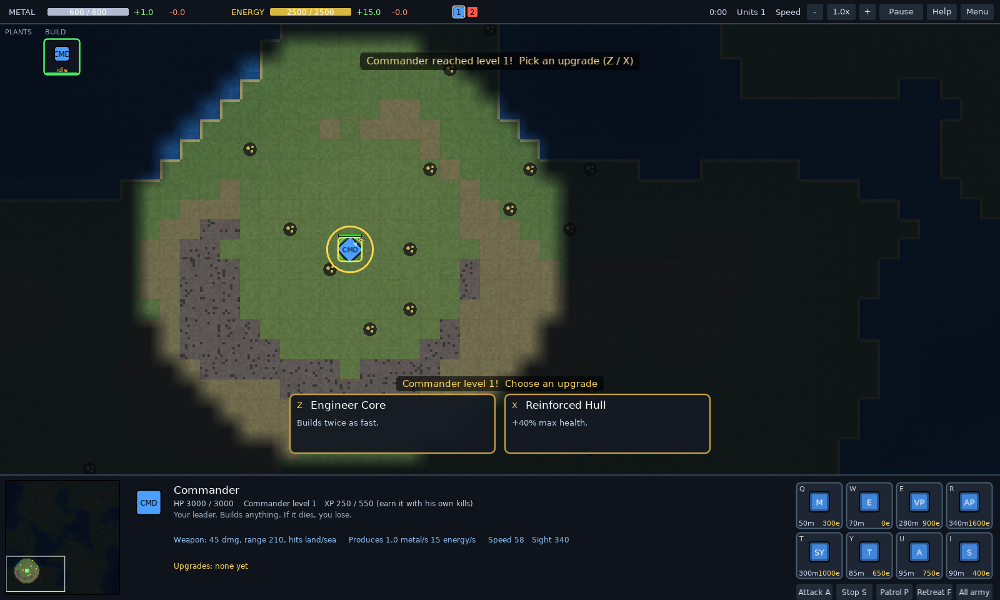 | 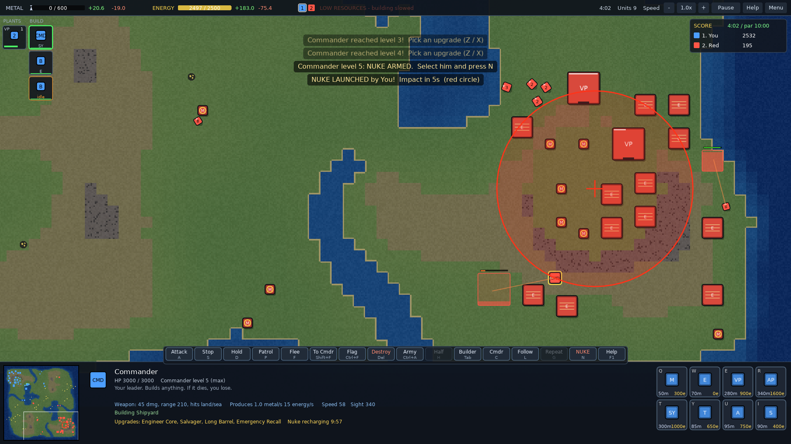 |
| 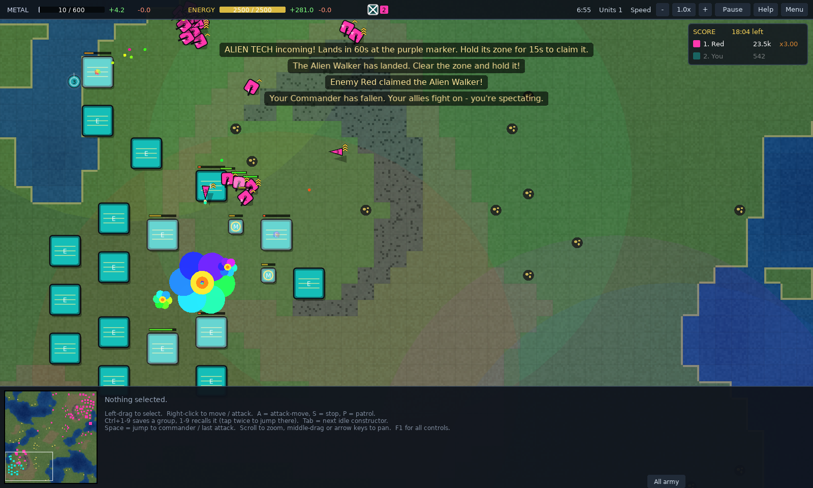 | 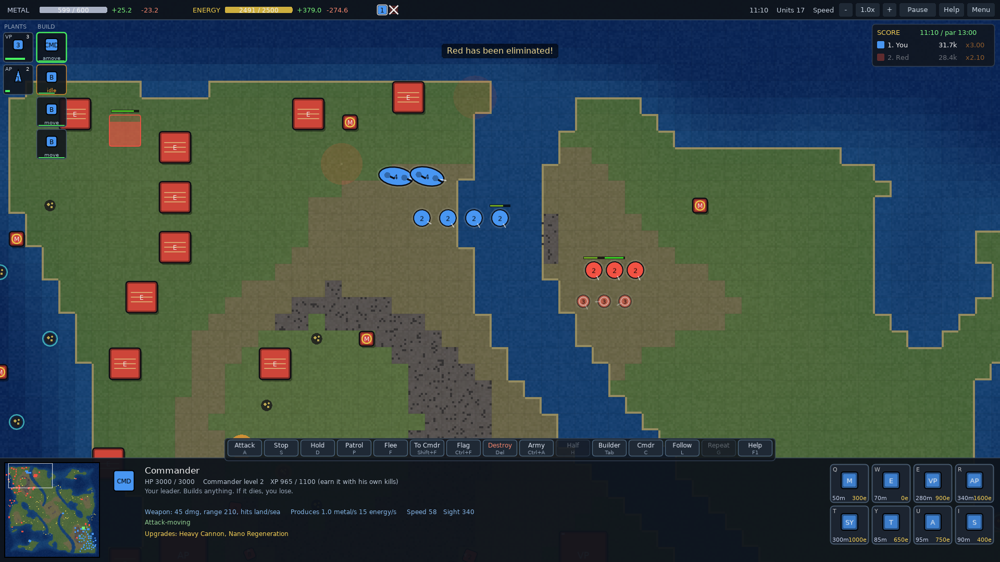 |
| 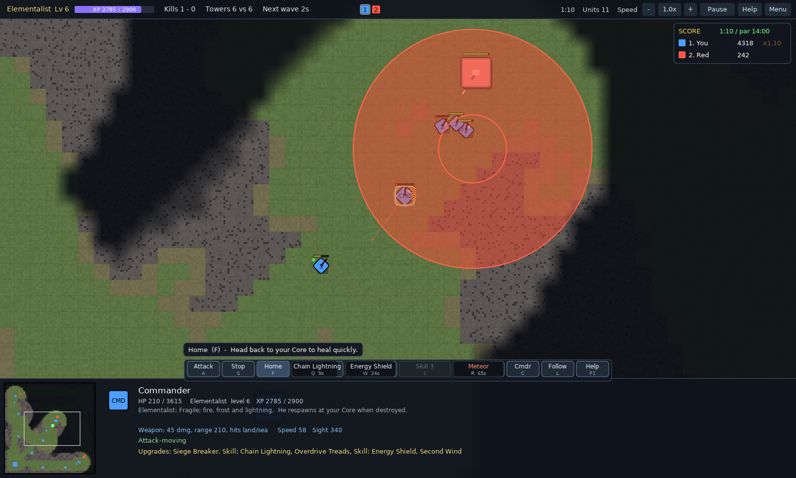 | 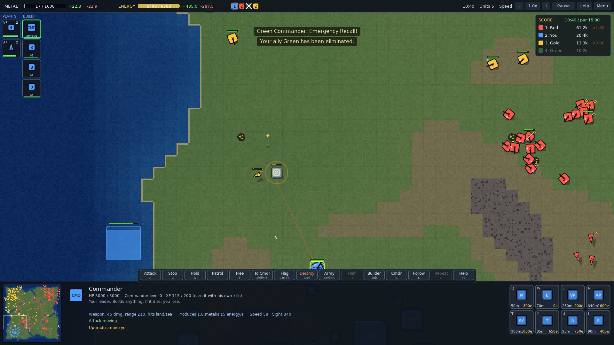 |
| 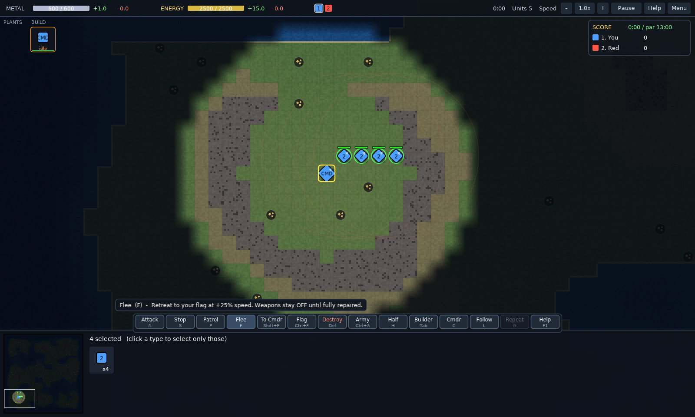 | 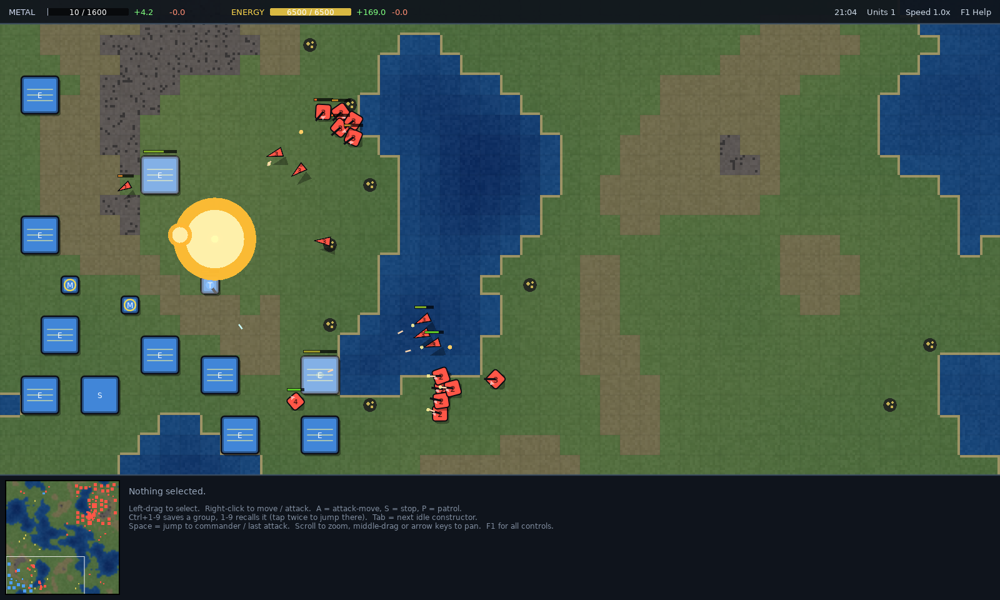 |
| 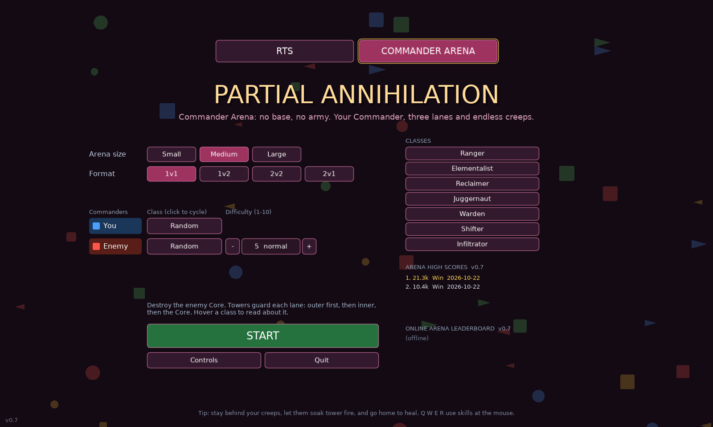 | |

## Units

Shapes tell you the domain, and the number tells you the type:

| Shape | Domain | Units |
|---|---|---|
| Square | Land | Constructor (B), Scout (1), Tank (2), Artillery (3), Flak Truck (4), Commander (CMD) |
| Triangle | Air | Fighter (1), Bomber (2), Gunship (3) |
| Circle | Sea | Sea Constructor (B), Patrol Boat (1), Destroyer (2), Submarine (3, only ships can hit it), Battleship (4, long oval hull) |

**Mirror and Nemesis.** Finish five Annihilation games on a version (win or lose; games you quit don't count) and two new enemy personalities unlock. **Mirror** plays like you: your unit mix, expansion speed, defences and attack timing, learned from your last games. **Nemesis** plays against you: it finds two of your habits (no anti-air, slow expansion, few defences, too many tanks...) and builds to punish them. Both pick their own strength from your record, and they reset with each new version.

**Artillery needs spotters.** It only sees 270, but shoots 440: it fires at full range only at targets a friendly unit or building can see. Scouts see farthest (420), so a Scout or two parked at the edge of an enemy's defences turns your artillery loose on them.

**Buildings:**
- Metal Extractor
- Solar Collector
- Tidal Generator (on water)
- Sea Battery (on water; hits land, sea and air)
- Storage
- Vehicle Plant
- Aircraft Plant
- Shipyard
- Gun Tower
- AA Tower

## Play in your browser

**[brianchase515.github.io/partial-annihilation](https://brianchase515.github.io/partial-annihilation/)**: no install, about a 14 MB download. The browser version runs slower than the desktop builds in very large battles, and it has no online leaderboard or updater. For the best experience, grab a download below.

## Download

| Platform | Download | How to run |
|---|---|---|
| **Windows** | [PartialAnnihilation-windows.zip](dist/PartialAnnihilation-windows.zip) | Unzip and double-click `PartialAnnihilation.exe`. If Windows warns about an unknown publisher, click *More info*, then *Run anyway*. |
| **Linux / Steam Deck** | [PartialAnnihilation-x86_64.AppImage](dist/PartialAnnihilation-x86_64.AppImage) | Make it executable (`chmod +x`, or *Properties, Permissions, Is executable*) and run it. |
| **Mac (or any OS with LÖVE 11.5)** | [PartialAnnihilation.love](dist/PartialAnnihilation.love) | See below. This version also updates itself from the title screen. |

The game fits itself to your screen: small displays such as the Steam Deck's 1280x800 run fullscreen automatically. `F11` toggles fullscreen.

### Steam Deck
1. In **Desktop Mode**, download the AppImage and mark it executable.
2. In Steam (still in Desktop Mode), choose **Games, Add a Non-Steam Game to My Library**, browse to the AppImage, and add it.
3. Back in **Gaming Mode**, open the game's controller settings and pick the **Gamepad with Mouse Trackpad** template. The game has its own controller support (below), and the right trackpad stays a mouse.
4. The back grips (L4 L5 R4 R5) aren't seen by games directly; bind them to keys you like, for example `Alt`, `F` (flee), `D` (hold fire) and `Space`.

## Controller

Any Xbox-style pad, a PlayStation pad or the Steam Deck's own controls. Keyboard and mouse keep working alongside it. A hint bar shows what each button does in the current mode (turn it off, or change the pointer speed, in Settings).

| Button | Everywhere |
|---|---|
| Left stick | Pointer (the trackpad / mouse move it too) |
| Right stick | Pan the camera |
| LT / RT | Zoom out / in |
| A | Left-click (hold and move to box-select) |
| B | Right-click (orders) |
| LB / RB | Hold for Shift / Ctrl (Arena: skills E / R) |
| D-pad | 1-4: groups or squads (RB + D-pad saves a group, LB adds) |
| Start | Menu |
| Y (hold) | Command wheel: tilt the left stick at an entry, let go of Y |

| | Annihilation | Commander of Heroes | Arena | Craft |
|---|---|---|---|---|
| X | Attack-move | Skill 1 (Q) | Skill Q | Skill / slot 1 |
| Y (tap) | Stop | Skill 2 (W) | Skill W | Skill / slot 2 |
| View | Idle builder | Next squad (C) | Go home | Idle worker |
| L3 | Jump to Commander | Squad 5 | Center | Next hero |
| R3 | Retreat | Flee active squad | Stop | Center |

The Windows and Linux builds can't replace themselves while running, so their update button opens this page instead.

## Playing on a Mac

1. Install **LÖVE 11.5** from [love2d.org](https://love2d.org) (the macOS download is a universal app). Move `love.app` into your **Applications** folder. If you run it straight from Downloads, macOS launches it from a temporary hidden copy, so any folder permission you grant doesn't stick and you'll be asked again on every launch.
2. Build the game file. Run `tools/build.sh`, or zip the contents of this folder (`main.lua`, `conf.lua`, `src/`, `assets/`) into `PartialAnnihilation.love`.
3. Run it with `open -n -a love PartialAnnihilation.love`, or drag the `.love` file onto `love.app`.

Or download the newest build directly: [`dist/PartialAnnihilation.love`](dist/PartialAnnihilation.love). After that, the game updates itself from its title screen.

The same `.love` file runs on Windows and Linux with LÖVE 11.5.

If you keep the game in Documents, Desktop or Downloads, macOS asks once whether LÖVE may use that folder (the game reads itself from there and writes its match logs beside it). Allow it once and you won't be asked again. A folder like `~/Games` doesn't ask at all.

## Kiting, attack-move and sight

- **Kiting:** a ranged unit that is fighting (attack, attack-move, patrol, guard or idle) steps back from a shorter-ranged enemy closing in and keeps shooting. It won't run from something it can't shoot or from something much faster than itself (a Scout swarm on artillery). Plain moves and group moves never kite. In Commander Arena, Commanders kite enemy Commanders only, never the creep wave. Computer players kite from level 4 up; level 8+ do it every time.
- **Attack-move marches:** a group attack-move first forms ranks where it stands (short reach in front, long guns behind, up to 6 s), then walks at the slowest unit's pace until anyone makes contact; then everyone fights freely. Level 5+ computer armies march too.
- **No shooting into the fog:** a target beyond a unit's own sight must be seen by a friendly unit or building. Artillery and battleships rely on spotters.

## Controls

| Action | Keys |
|---|---|
| Select / add | Left-click or drag; Shift adds; double-click selects all of a type on screen |
| Move / attack / assist | Right-click (Shift queues) |
| Attack-move, Stop, Patrol | `A` then click, `S`, `P` then click |
| Game speed | `+` / `-` (0.5x up to 15x; the result never depends on speed) |
| Restart the same map / Settings | Esc menu: Restart (same map), Settings (window size, camera scroll and zoom speed, trackpad pan speed, edge scrolling, volumes; also on the title screen) |
| Plant retreat flag | `Ctrl+F` at the mouse (or the Flag button, then click) |
| Guard a unit / factory output follows a unit | Right-click a friendly unit with army / a factory selected |
| Commander flees home (repairs only there) | `F` with the Commander selected |
| Arena skills / ultimate | `Q` `W` `E` / `R` at the mouse (Arena) |
| Hold fire (time your last hits) | Hold `D` (or click Hold) |
| Deny your own creep (Arena) | Right-click your creep under 35% health |
| Self-destruct selection | `Delete` (unfinished buildings refund their metal; the Commander needs two presses) |
| Drop last queued order | `Shift+Delete` |
| Retreat to flag / Commander | `F` / `Shift+F`; plant the flag with `Ctrl+F` |
| Commander upgrade choice | `Z` / `X` (or click a card) |
| Nuke (Commander level 5) | `N`, then click the target |
| Select all combat units | `Ctrl+A` / `Cmd+A` |
| Select half / other half | `H` / `Shift+H` |
| Control groups | `Ctrl+1-9` save, `Shift+1-9` add, `1-9` recall (tap twice to jump there) |
| Build / produce | `Q W E R T Y U I` with a constructor or factory selected; drag for an area |
| Factory output to group | `Option+1-9` (`Option+0` clears) |
| Camera | Scroll to zoom; middle-drag, arrow keys or screen edge to pan; `Option`+scroll pans |
| Follow / cinematic camera | `L` / `Shift+L` |
| Jump to Commander / last attack | `C` / `Space` |
| Idle constructor | `Tab` |
| Sidebar, speed, pause | `B`; `+`/`-`; `F3` (the top bar is clickable too) |
| Sound effects / music / announcer | `M` / `Shift+M` / `V` |
| Help | `F1` |

## How it's built

Plain Lua on LÖVE 11.5, with no other dependencies.

| File | What it does |
|---|---|
| `src/map.lua` | Procedural symmetric maps and connectivity |
| `src/path.lua` | A* pathfinding with smoothing and per-frame budgets |
| `src/world.lua` | The simulation: economy, construction, combat, veterancy, fog of war, retreat and repair |
| `src/ai.lua` | Computer opponents: economy, production, waves, raids, retreating, Commander tactics, nuke targeting, multi-enemy targeting |
| `src/commander.lua` | Commander levels, the 20-upgrade pool and the Nuke |
| `src/mods.lua` | Game modifiers: Alien Tech, Dropships, Metal Alert, Post-Apocalypse, Score mode |
| `src/scores.lua`, `src/online.lua` | Local high scores; update check, one-click update and online leaderboard (via `curl` and GitHub) |
| `src/matchlog.lua` | Per-game logs for balance review |
| `src/arena.lua`, `src/arena_ai.lua` | Commander Arena: lane map, towers, creep waves, the seven classes and their skills, and the computer Commanders |
| `tools/compose_suites.py` | The four extra soundtracks |
| `tools/sfx.py` | Synthesizes the combat sound effects |
| `tools/leaderboard.py`, `.github/workflows/leaderboard.yml` | The leaderboard bot: checks a submitted score issue, updates `LEADERBOARD.md`, then replies and closes the issue |
| `src/game.lua`, `src/ui.lua`, `src/render.lua` | Input, the HUD and drawing |
| `src/menu.lua`, `src/maps.lua` | Lobby and saved maps |
| `src/sfx.lua` | Positional combat sounds and UI blips |
| `src/music.lua`, `src/voice.lua` | Intensity-driven music crossfading and the announcer queue |
| `tools/compose.py`, `tools/voices.py` | Compose the score as MIDI and render it with FluidSynth (FluidR3 GM soundfont, MIT); render the announcer with espeak-ng plus a ring-modulator robot filter |

### Testing

Computer-vs-computer games run headless at high speed:

```sh
love . --autotest 25 <seed> <size> <level1> <profile1> <level2> <profile2> [--mods alien,drops,convoy,apoc,groovy]
love . --autotest4 30 <seed> 128 ffa|2v2|3
love . --arenatest 25 <seed> <size> 1v1|2v2|1v2 <level> [class1,class2,...]
love . --smoketest     # a scripted "player" drives the real input handlers
```

The AI tournament plays many computer-vs-computer games at full speed and fingerprints how each side played (when it made contact, how many groups it fought in, how much of the map it covered, its kill range, which unit types did the damage). It reports win rates and a variety score: how far apart the games are, and how many are near-repeats of another. `fixed` replays the same map, armies and levels, so the variety left is the AI's own.

```sh
love . --tourney <coh|wih|rts> [games] [level2|mix] [level1|mix] [fixed]
```

Every match log now ends with how each side played (the same fingerprint), who killed what, and the computer's decisions as they happened (objectives, raids, waves, breaks). The result screen asks how the game felt (fresh or samey, too easy or too hard) and saves the answer in the log.

### Releasing

Bump `VERSION` and `D.VERSION` in `src/defs.lua` together, then run `tools/build.sh` (it refreshes `dist/PartialAnnihilation.love`) and push. Players get the update from the title screen, and the leaderboard starts a new season for the new version.

## License

The game's code, music, sound effects and voices are MIT. See [LICENSE](LICENSE). The exception is War is Hell's screams and wounded cries: recorded voices from OpenGameArt by VoiceBosch (CC BY-SA 4.0), creativeheroes and thanvannispen (CC BY 3.0) and JohnsonBrandEditing (CC0), and CC0 recordings from Freesound. `assets/voice/CREDITS.md` has the details.

Unit and building icons are from [game-icons.net](https://game-icons.net) by Lorc, Delapouite, Cathelineau, Skoll, sbed, Caro Asercion and Pierre Leducq, used under [CC BY 3.0](https://creativecommons.org/licenses/by/3.0/). They were recolored to white silhouettes. `assets/icons/CREDITS.txt` lists which icon is which.
